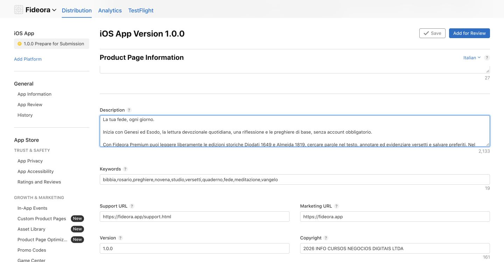

# Fideora 1.0.0 (5): final store preparation

## Executive summary

2026-10-21. Italian-first Bible, study and devotional app with optional Portuguese. User reports completing physical-device acceptance in TestFlight and restoring RevenueCat Sandbox Testing Access to Anybody. Build 5 was delivered automatically through Xcode Cloud. This is user-reported functional acceptance, not independent evidence of every runtime edge case. App Review submission remains pending.

## Risk register — first pass

| Priority | Area | Finding | Evidence | Review impact | Remediation | Effort | Confidence |
|---|---|---|---|---|---|---|---|
| P1 | Store metadata | Existing descriptions/review notes reference numerical book count and outdated free access | Live App Store Connect inspection | Misleading product information | Apply current bilingual PREMIUM-STORE-COPY and reviewer steps | Small | Verified |
| P1 | Screenshots | Italian primary iPhone slot has zero screenshots | Live listing | Incomplete submission | Capture actual current app on supported devices/locales | Medium | Verified |
| P1 | Binary selection | No binary selected for version | Live listing | Incomplete submission | Select tested 1.0.0 (5) | Small | Verified |
| P1 | First subscriptions | Product inclusion and review completeness require final check | Submission not yet assembled | Paid access unavailable to review | Verify subscription review metadata and include both products | Small | Pending |
| P2 | Privacy | Seven declared types include purchase history and identifiers; final publication status not yet verified | Live Privacy page | Disclosure consistency | Compare SDK and policy, verify published status | Small | Partial |
| P2 | Runtime evidence | User confirms testing; independent exhaustive lifecycle coverage unavailable | Conversation acceptance | Avoid claiming exhaustive independent QA | Preserve evidence limits and reviewer paths | Small | Verified limitation |
| P3 | Release control | Manual release selected | Live listing | Owner controls publication after approval | Preserve manual release | None | Verified |

## Reviewer journey

1. Install and launch build 5.
2. Onboarding offers Italian or Portuguese and optional display name. Close with X to continue without subscribing.
3. Account is optional; email sign-in is only for cloud sync.
4. Open Bible: Genesis and Exodus are free; daily devotional/reflection and basic prayers are also free.
5. Choose another included book or a Premium feature to show the RevenueCat paywall.
6. Purchase monthly or annual using Apple sandbox; annual trial is seven days for eligible accounts, monthly has none.
7. Restore from paywall or Profile; manage subscriptions from Profile.
8. Profile supports language, local name, export and optional email sync.
9. An authenticated user can initiate account deletion in Profile. Deletion does not cancel Apple billing.
10. Open privacy, terms and support links.
11. Check offline Bible access and usable network/billing error states.

## App Review Notes draft

Italian is the default; Portuguese can be selected during onboarding or in Profile. No Fideora account is required for the free journey or Apple purchases. Close onboarding with X to explore without subscribing. In Bible, Genesis and Exodus are free. Daily devotional/reflection and basic prayers are also free. Choose another included book or a Premium feature to open the RevenueCat paywall. Monthly and annual products grant the same premium entitlement. The annual product offers a seven-day introductory trial for eligible Apple accounts; the monthly product has no trial. The full annual amount is charged after the trial unless cancelled. Restore is available on the paywall and in Profile; Apple subscription management is in Profile. Optional email authentication enables sync; authenticated users can initiate account deletion from Profile. Existing personal content remains readable/exportable after expiry. There is no external checkout, advertising or generative AI. The historical Bible editions omit Catholic deuterocanonical books and are not official liturgical editions. Daily readings follow an editorial cycle; lexical cards are introductory, not a full interlinear.

Products: com.fideora.premium.monthly and com.fideora.premium.annual.

## Evidence and scope

- Xcode Cloud and automatic build-5 delivery: docs/XCODE-CLOUD.md.
- Physical acceptance: owner reported all tests completed in this conversation.
- Sandbox test access Anybody: owner confirmed step 1 completed.
- Review contact is already populated in App Store Connect; personal contact details are intentionally omitted from this public document.
- No App Review submission or public release performed during preparation.

## Store preparation actions completed

- Saved Italian and Brazilian Portuguese descriptions from PREMIUM-STORE-COPY, including free Genesis/Exodus and no numerical Bible book count.
- Saved the English reviewer journey notes and retained optional sign-in, existing review contact, and manual release.
- Selected App Store eligible build 1.0.0 (5) for the version and saved.
- Declared third-party content rights based on the historical public-domain corpus documented in README.
- Set the app download price to zero. Premium subscriptions remain separate, unchanged purchases.
- Prepared initial availability in Italy, Brazil and Portugal; other territories can be added before or after launch.
- Public privacy, terms and support URLs returned HTTP 200; the live privacy policy includes RevenueCat purchase processing.
- App Privacy contains seven types matching the app manifest, including purchase history, linked user IDs and paywall interactions. Purchase history uses Analytics and App Functionality, as required by RevenueCat documentation. Publication remains pending the owner's accuracy attestation.
- Annual/monthly subscription group exists at the same service level with IT/PT localizations. Annual subscription review screenshot still requires an actual current screenshot; no subscription has been submitted for review.
- Separate assets branch runs simulator capture only and does not upload a replacement TestFlight binary.

Metadata evidence: .

Sources consulted: https://www.revenuecat.com/docs/platform-resources/apple-platform-resources/apple-app-privacy and https://developer.apple.com/help/app-store-connect/manage-app-information/manage-app-privacy .

## Final preparation checkpoint — 2026-10-22 UTC

- Native iPhone capture job passed: https://github.com/talescor-spec/mappa-cattolico/actions/runs/39696755771/job/119555892537 . Twelve native PNGs were produced at 1206 × 2622; four marketing screens per language were selected after visual inspection.
- Native iPad capture passed after allowing enough time for cold WebKit initialization: https://github.com/talescor-spec/mappa-cattolico/actions/runs/39700331699 . Eight native PNGs were produced at 2064 × 2752, covering Today, Bible, Prayer and Notebook in both languages. All were inspected visually.
- The deliverable contains 16 marketing screenshots and one Portuguese native paywall screenshot for subscription review, plus a README. The review paywall shows the simulator's US storefront prices; marketing images contain no prices.
- Captures use the same application source as tested build 5. Only capture automation and review documentation changed on the assets branch; no replacement TestFlight binary was uploaded.
- All 17 PNGs and the complete ZIP were saved successfully as owner deliverables. Their private file identifiers are intentionally omitted here.
- Apple version 1.0.0 still has the tested build 5 selected. Italian/Portuguese descriptions and reviewer notes are saved. Both subscription products have appropriate reviewer notes saved.
- App Privacy policy URLs were checked in both localizations. The declaration remains unpublished, pending the owner's accuracy attestation.
- App Store screenshot upload was attempted through the documented file chooser. The chooser supports multiple images, but Chrome blocked setFiles because the ChatGPT extension needs "Allow access to file URLs" enabled. No screenshots were uploaded. User action is required before retrying; do not report the store page as complete until the gallery counts and both subscription review screenshots are verified after upload.
- No App Review submission or public release has been performed. Remaining gates: browser file access and asset upload; privacy publication; assembling the first app/subscription review submission.

The user-facing browser instructions for this blocker are supplied by the control-browser runtime's Chromium file-upload troubleshooting guide. This is a technical permission requirement; it is separate from the owner's App Privacy accuracy attestation.
