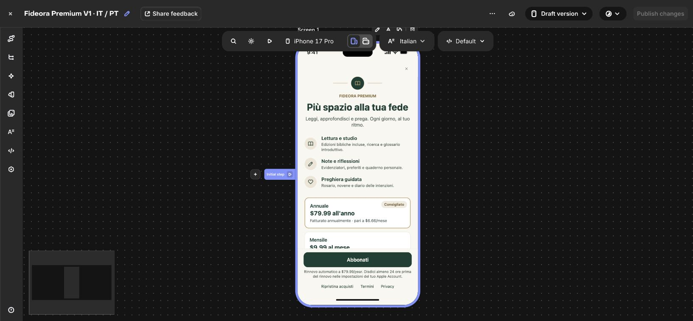

# Fideora 1.0.1 — direct native paywall

The last onboarding action and locked-feature actions request the RevenueCat paywall directly. The former benefits modal is removed from the normal path. A compact retry/restore dialog appears only if checkout cannot be presented. Closing the native paywall returns to the app without reopening it.

Billing remains on the existing Apple products, default offering, and `premium` entitlement. The client still validates CustomerInfo; a purchase result alone never unlocks content. Authentication hydration is allowed to finish before presenting checkout, requests are deduplicated, and results from a previous account cannot unlock the new account.

## Remote paywall design

RevenueCat project: Fideora (`0df93c61`). Existing paywall: `wfc1f6a56c9adc4b9a`.

- Warm ivory / forest green / muted gold, book motif, three benefit rows.
- Italian default and Portuguese (Brazil).
- Annual selected by default, monthly alternative.
- Store-derived total price, period, annual monthly equivalent, and introductory-offer duration.
- Introductory copy and CTA depend on the selected package's eligible introductory offer. Current configured offer is a free annual trial; recheck this copy if changing to a paid introductory discount.
- Close is a minimal 14-point native X icon with no background/border, a transparent 44×44 touch target, and muted light/dark colors. The shipped RevenueCatUI 5.95.0 derives its localized accessibility label from the navigate-back action.
- Fixed header keeps Close reachable; fixed footer keeps the purchase CTA, price/renewal terms, Restore, Terms and Privacy reachable while content scrolls. No countdown, review claims or reminder promises.
- Editor preview prices and English variable sample units are placeholders, not App Store billing values.

## Validation

- 30 automated tests, including five direct-checkout integration cases.
- App Store structural preflight: 24 checks.
- Production web build and Capacitor iOS synchronization.
- Dependency audits: no vulnerabilities at preparation time.
- RevenueCat editor visual review: Italian / Portuguese; normal / introductory offer; iPhone SE scrolling and iPad mini; light / dark appearances.

Signed iOS archive and TestFlight Internal Testing distribution succeeded in Xcode Cloud build 6 on `fideora-premium-v1`, source commit `a438dcad6be0f7b0612b5d57aac406acba73659e`. App Store Connect lists version 1.0.1 (6), assigned to Fideora QA Interno (one tester). A real Apple purchase confirmation and an on-device check of this new layout remain part of release QA. Changing the remote paywall can reach existing app versions; removing the intermediate screen requires the 1.0.1 binary. No App Store review submission is included in this change.

## Published design evidence

