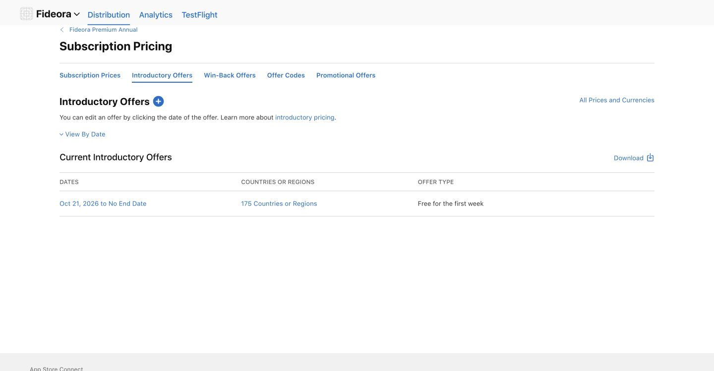

# Fideora — grátis e Premium

Atualizado em 21/10/2026. Esta entrega substitui a divisão gratuita da V1 anterior. Configuração comercial preparada; compra real via StoreKit ainda depende da etapa Apple e de aceite em aparelho.

## Acesso

O objetivo de 10%/90% foi operacionalizado em dez grupos de funcionalidades, não em contagem de versículos ou minutos. A rotina diária e as orações básicas formam a experiência grátis. Privacidade, conta opcional, suporte, acessibilidade, conteúdo pessoal existente e exportação não entram nessa contagem.

| Grupo | Grátis | Premium |
|---|---|---|
| Experiência diária | Passagem completa do dia, reflexão, meditação registrada e orações básicas | Incluída |
| Leitura livre | Apenas passagem diária | Navegação por todos os livros/capítulos incluídos |
| Busca bíblica | — | Busca no corpus |
| Anotações | Conteúdo já criado permanece acessível | Novas notas e destaques por versículo |
| Favoritos | Favoritos existentes acessíveis | Salvar novos versículos |
| Caderno | Ler, editar, excluir e exportar estudos existentes | Criar novos estudos |
| Guias | Capas/temas visíveis | Quatro guias editoriais |
| Glossário | Palavras/títulos visíveis | Oito verbetes com referências |
| Rosário guiado | Orações tradicionais avulsas | Sequência completa em 67 etapas |
| Devoções | Intenções já escritas acessíveis | Novenas e novas intenções |

O leitor contém edições históricas de 66 livros por idioma, sem deuterocanônicos, e isso permanece informado. O glossário é introdutório. Não há promessa de Bíblia católica completa, áudio ou interlinear completo.

## Oferta configurada

- RevenueCat: projeto Fideora `0df93c61`; app iOS `appfb1ff980e3`; Bundle ID `com.fideora.app`.
- Entitlement: `premium`. Oferta padrão `default` (`ofrngd28f24542a`).
- Paywall publicado: `wfc1f6a56c9adc4b9a`, Fideora Premium V1 · IT / PT. Italiano padrão; português do Brasil adicional; inglês removido. Três benefícios, botão de fechar, restauração, termos, privacidade e renovação.
- Pacotes reais: `$rc_monthly` → `com.fideora.premium.monthly`; `$rc_annual` → `com.fideora.premium.annual`. Ambos vinculados ao mesmo entitlement.
- Apple: grupo `22500299`; mensal `6825362133`; anual `6825368737`.
- Ambos os planos estão no nível 1 do mesmo grupo Apple. Duração mensal de um mês e anual de um ano; sem compromisso anual parcelado. Localizações dos produtos e do grupo salvas em italiano e português do Brasil.
- URLs de notificações Apple → RevenueCat salvas para produção e sandbox. Ainda sem transações para comprovar entrega dessas notificações.
- Preços base aprovados pelo usuário e salvos para Itália: **€19,00/mês e €59,00/ano**, com equivalências locais recalculadas pela Apple nos 175 países/regiões. No Brasil, a tabela Apple resultou em R$99,90/mês e R$299,90/ano. O SDK mostra o preço do storefront, sem valores fixos no código do paywall. **Anual: teste grátis de sete dias para contas elegíveis. Mensal: sem trial.** Sem oferta vitalícia. Essa configuração substitui a hipótese inicial de €4,99/€29,99.
- A prévia do editor RevenueCat pode usar preços fictícios do Test Store ($9,99/$79,99). Esses valores não são os preços base Apple configurados. O código de produção rejeita chaves Test Store.
- Trial Apple anual salvo: oferta gratuita de uma semana, início em 21/10/2026, sem data final, 175 países/regiões. Após o trial, cobrança do ano integral se não houver cancelamento. A elegibilidade é determinada pela Apple no grupo de assinaturas.
- Paywall RevenueCat atualizado e publicado com regra nativa de oferta introdutória: Prova gratis / Experimente grátis e duração de sete dias apenas na variante elegível; Abbonati / Assinar na variante regular. Total anual continua dinâmico e destacado; equivalente mensal é secundário. A duração está localizada como 7 giorni / 7 dias: se a duração Apple mudar, atualizar também essas duas traduções.
- Fluxo comercial é exclusivamente Apple IAP/RevenueCat. O usuário informou que não utiliza mais Stripe; nenhuma integração Stripe foi adicionada ou reativada.
- Nenhuma cobrança, compra real ou submissão à Apple foi efetuada pelo agente.

## Insights estudados e aplicação

| Referência | Aplicação no Fideora | Limite da evidência |
|---|---|---|
| Reels anexado sobre Block Blast | Oferta contextual no momento de interesse; preservar a rotina e dar um próximo passo | As alegações de manipulação do jogo são do autor do vídeo; não foram verificadas independentemente. Dificuldade adulterada, perdas artificiais e segmentação por valor publicitário não foram aplicadas |
| [Dan Kulkov](https://x.com/DanKulkov/status/2105952298669379796) | Dois planos, três benefícios, preço localizado e foco em receita paga | Resultados autorrelatados; não se transferem automaticamente ao Fideora. Vitalício não foi escolhido, pois o pedido prioriza assinaturas |
| [Ethan Cajigas](https://x.com/aureliuscajigas/status/2088304647014641893) | Proposta específica para leitura/estudo/oração, medir a jornada até pagamento | Rotinas de mídia e aquecimento de contas não foram executadas; não foi instalado Meta SDK nem enviado conteúdo religioso para anunciantes |
| [Jake Castillo](https://x.com/jakecastilloooo/status/2080670471394091502) | Onboarding em três etapas: objetivo, tempo e plano; oferta após demonstração real; anual principal | Métricas do post são alegações do autor. Não tratamos benchmarks agregados como metas garantidas nem copiamos 30 telas de onboarding |
| [David Ch](https://x.com/chhddavid/status/2100537116635672690) | Clareza da promessa e sequência curta até o primeiro valor | Distribuição paga, creators e orçamento não foram alterados |
| [Gabriel Buzzi](https://x.com/gabrielbuzziv/status/2098464877018767382) | Roteiro Apple App Store Reviewer já existente no repositório foi aplicado antes das mudanças | A skill ajuda a auditar; não garante prazo ou aprovação Apple |

Os posts foram lidos na sessão conectada do X, pois a busca pública não recuperou os artigos. Nenhum post foi curtido, enviado ou comentado. O reels foi analisado pela transcrição anexada e por inspeção visual de frame.

## Implementação e verificação

- SDKs oficiais `purchases-capacitor` e `purchases-capacitor-ui` 13.7.4, incluídos no projeto iOS via Capacitor/SPM.
- Estado Premium vem de CustomerInfo e do entitlement ativo, sem booleano local para desbloqueio. Compra/restore consultam novamente o SDK; cancelamento não desbloqueia.
- Identidade RevenueCat serializada, independente da hidratação Supabase; descarte de respostas antigas ao trocar conta e logout do usuário retido antes da sessão visitante.
- Atualização por listener, retorno do app, rede e verificações periódicas. Cache expirado não vira acesso permanente.
- Onboarding e paywall bilíngues; fechamento imediato; sem urgência, depoimentos, descontos ou trial inventados.
- Política de privacidade e manifesto atualizados para transações, identificador e interação com o paywall. Objetivo, tempo e textos privados não são enviados ao RevenueCat.
- 20 testes passaram; 24 verificações estruturais passaram; build web e sincronização iOS passaram; auditoria npm sem vulnerabilidades.
- [Build e abertura iOS no simulador](https://github.com/talescor-spec/mappa-cattolico/actions/runs/39610924305): sucesso com os SDKs novos. Isso não comprova compra StoreKit nem execução em aparelho físico.
- Prévia web: onboarding e objetivo/tempo, bloqueio de novas notas e Rosário, passagem diária limitada, troca IT/PT, fechar oferta e estado de plataforma sem compra. 390×844 e 320×568 sem overflow horizontal; console sem erros.
- Prévia final disponível: https://mappa-cattolico-2wiek2tjr-thales-projects-54040b4e.vercel.app (commit `1bc1a95797ad3d1719e71b363c8c98c9a57b6148`). Produção permanece na V1 gratuita enquanto falta aceite StoreKit.
- Rascunho App Privacy salvo com sete tipos de dados. Compras, User ID e Product Interaction: funcionamento e analytics, vinculados à identidade, sem tracking. A prévia não apresenta mais a classificação contraditória de identificadores/interações como dados desvinculados. Publicação final ainda pendente.
- Descrições IT/PT e notas para review estão em `PREMIUM-STORE-COPY.md` e preenchidas na página Apple. **O salvamento da versão foi rejeitado porque faltam nome, sobrenome, telefone e e-mail do contato de review.** O texto novo dessa página está sem salvar; não considerar os metadados da versão atualizados no servidor. Nenhum contato foi inventado.
- CI Security & Build Check do commit final: sucesso (`39615102670`). Execução do simulador `39615095100` terminou sem executar etapas: job `119273890785` cancelado, lista de steps vazia (o run aparece como failure). Isso não é evidência de compilação dessa revisão. A execução anterior com os SDKs RevenueCat passou, conforme link acima; manter o aceite nativo final pendente.

## Pendências antes de cobrar e enviar para review

1. Account Holder revisar o contrato Apple pendente (Paid Applications Schedule). O agente não aceitou contrato.
2. Finalizar e revisar registros Apple: screenshots de review dos IAPs e do app, publicar App Privacy conferido, fornecer contato de review para salvar as novas descrições/notas, direitos de conteúdo, e associação dos IAPs à versão.
3. Archive assinado, TestFlight e teste em iPhone: compra de cada plano, cancelamento, restauração com mesmo Apple ID, expiração, troca de conta, login e exclusão.
4. Conferir preços, idioma, termos e todos os botões no paywall nativo com produtos reais do sandbox. Validar a recuperação de billing e mudança mensal/anual no mesmo nível.

A publicação do paywall no RevenueCat e a criação dos produtos Apple não significam que a assinatura esteja aprovada ou pronta para cobrança pública. `npm run appstore:release` continua exigindo evidências reais.

## Próximo experimento

Comparar uma mudança por vez com tráfego suficiente: preço anual/mescla de planos, três etapas vs oferta mais curta, anual com sete dias de trial vs anual sem trial em experimento posterior. Medir compra paga por instalação, receita líquida por usuário, reembolso, cancelamento e retenção; trial iniciado não equivale a venda. Nenhum ganho percentual é alegado sem teste controlado no Fideora.

## Evidência da atualização de preços e trial

21/10/2026: usuário aprovou €19/mês e €59/ano com sete dias grátis no anual. Preço mensal reaberto e verificado na linha Italy (EUR) €19.00. Preço anual reaberto e verificado na linha Italy (EUR) €59.00. Trial salvo e verificado como Free for the first week em 175 países, de 21/10/2026 a No End Date. A apresentação desses dados no iPhone ainda será conferida no próximo teste StoreKit. 20 testes, build web e 24 verificações estruturais passaram novamente após a atualização dos termos. A medição de conversão ainda não foi realizada.

## Domínio próprio — 21/10/2026

https://fideora.app está em produção com HTTPS; www redireciona para a raiz. A PR #5 publica somente o domínio, canonical e páginas legais atuais sobre a V1 web existente. A versão Premium permanece na PR #4 até o aceite nativo. Links legais IT/PT do paywall RevenueCat publicados no novo domínio; Privacy Policy URLs Apple salvas. Descrições e URLs da página da versão Apple estão preparadas sem salvar, dependendo do contato de review. DNS HostGator preparado, mas caixa support@fideora.app ainda depende do login no portal. Callback Supabase preservado até acesso à conta correta. Ver DOMAIN-INTEGRATION.md para evidências e pendências.

## Backend exclusivo preparado — 21/10/2026

Projeto sysuottboucultzzaagv configurado com três tabelas e nove políticas RLS. Teste real de isolamento/exclusão com dois usuários passou em dez propriedades; fixtures revertidas. Cliente e CSP da branch preparados para o projeto exclusivo, sem promover Premium nem trocar o backend da produção. Auth URL/SMTP e nome no painel continuam pendentes devido à indisponibilidade da conexão do navegador. Build, 20 testes e 24 verificações estruturais passaram. Ver DEDICATED-SUPABASE.md.

## Preparação TestFlight — estado atualizado

O titular informou aceite do contrato Apple e confirmou recebimento/login por e-mail. Backend exclusivo ativado em fideora.app, conforme DEDICATED-SUPABASE.md. O workflow iOS Simulator 39652187002 do commit 54bc3091fd2546997008b7183211fb4d94b8632a terminou com sucesso, compilando e abrindo o app. Não há nova evidência de archive assinado, upload/processamento TestFlight ou compra/restauração em iPhone. As pendências históricas de contrato e backend acima ficam substituídas por esta atualização; contato de review e estado atual do portal não foram reconferidos. Passo a passo de assinatura, envio e aceite preparado em TESTFLIGHT-SETUP.md. Nenhuma submissão Apple foi executada.
