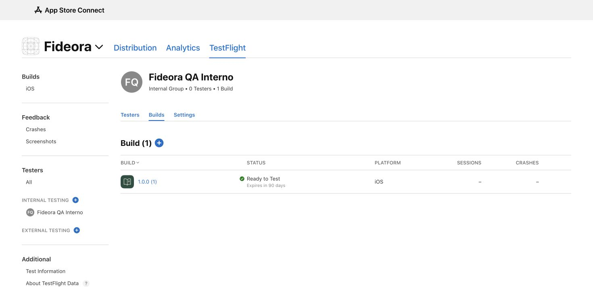

# Fideora — TestFlight 1.0.0 (1)

Verificado no App Store Connect em 21/10/2026, após envio pelo titular via Xcode.

## Estado confirmado

- App Apple: 6825337165; nome Fideora; Bundle ID com.fideora.app.
- Versão 1.0.0, build 1. Upload exibido em 21/10/2026 às 16:49, horário do painel.
- Build Uploads: Complete. Build Metadata: Binary State Validated.
- Assinatura de distribuição no metadata: application-identifier CZ7QKZBQC8.com.fideora.app; equipe CZ7QKZBQC8; get-task-allow false; beta-reports-active true.
- App Uses Non-Exempt Encryption: No. Includes Symbols: Yes.
- Destinos: iPhone e iPad; arm64; mínimo iOS 15.0. Localizations no metadata Apple: Italian. A seleção de português dentro do app deve ser conferida no aparelho.
- Grupo interno Fideora QA Interno criado com distribuição automática desativada e build 1 associada. Status Ready to Test; zero testadores no momento desta verificação. Nenhum convite enviado.
- Texto What to Test salvo em italiano, com cenários de idioma, uso gratuito, paywall, compras mensal/anual, elegibilidade do trial, restauração, expiração, conta, exclusão de conta QA, suporte e modo offline.
- URL do grupo: https://appstoreconnect.apple.com/teams/1f404b10-6425-4a63-9483-a4bc8a3f49d7/apps/6825337165/testflight/groups/e73db516-080e-4121-89a7-88443574942f.
- URL da build: https://appstoreconnect.apple.com/teams/1f404b10-6425-4a63-9483-a4bc8a3f49d7/apps/6825337165/testflight/ios/3f58fea2-0faf-42ea-a93e-8007b49b6310.

## Limites e próximo aceite

A validação do binário pela Apple e o status Ready to Test não comprovam compra StoreKit, restauração, expiração, login/exclusão no iPhone ou aprovação pública. Esses cenários continuam pendentes. Não foi gerada outra build, não foi submetida uma versão à App Review e não foi mesclada a branch Premium.

O código iOS validado previamente em CI usa o commit 54bc3091fd2546997008b7183211fb4d94b8632a, com revisões de documentação posteriores. O portal Apple não revela o Git SHA do archive local; não é declarado vínculo criptográfico entre archive e commit. A instalação real deve verificar paywall Premium e backend exclusivo.

## HD externo — correção confirmada pelo titular

O Xcode havia salvo literalmente /Volumes/THALES%20HD%20500GB%20/Fideora-Build/DerivedData/, pasta inexistente. Após fechar o Xcode, os dois destinos foram corrigidos com defaults write para os caminhos físicos do disco montado. A leitura posterior confirmou /Volumes/THALES HD 500GB /Fideora-Build/DerivedData, e df confirmou /dev/disk7s1 no HD externo com 401 GiB livres naquele momento. O nome real do volume termina com espaço. Não renomear nem reformatar o volume para reproduzir a correção.

Os campos IDECustomDerivedDataLocation e IDECustomDistributionArchivesLocation foram atualizados para DerivedData e Archives dentro de Fideora-Build. O cache padrão acompanha DerivedData. O titular confirmou compilação e envio concluídos depois da correção. Isso não comprova que o checkout ou node_modules também foram movidos para fora do disco interno.

Roteiro de aceite e assinatura: TESTFLIGHT-SETUP.md. O estado verificado neste documento substitui as pendências históricas de archive/upload nos relatórios anteriores. Os demais itens de review continuam sujeitos ao gate APP_STORE_REVIEW_GATE.md e ao teste físico.
