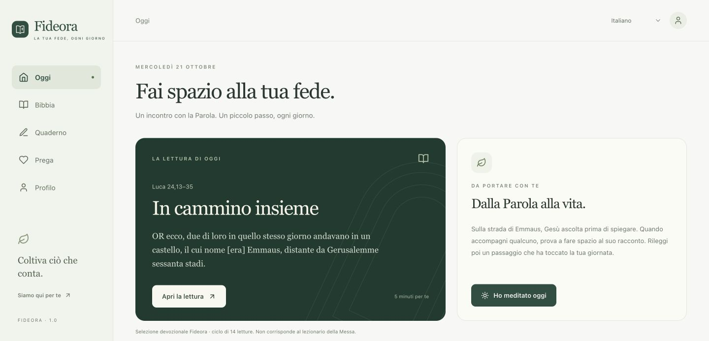

# Fideora V1 — entrega e validação

Data: 21/10/2026.

Versão publicada: https://mappa-cattolico.vercel.app

Código integrado à branch principal: https://github.com/talescor-spec/mappa-cattolico/pull/2

Cadastro Apple: https://appstoreconnect.apple.com/apps/6825337165/distribution (1.0.0, Prepare for Submission). Bundle ID `com.fideora.app` registrado na equipe `CZ7QKZBQC8`.

**Implementação V1 concluída. Build web validada. Compilação e abertura no simulador iOS comprovadas. A submissão à Apple permanece bloqueada pelo contrato Apple atualizado, assinatura e validação em aparelho físico.**

## O que mudou

- Interface com navegação lateral no desktop e cinco abas no celular; tipografia editorial, verde profundo, superfícies claras e controles de leitura.
- Apenas italiano e português; italiano como padrão inicial.
- Leitor com as edições históricas Diodati 1649 e Almeida 1819: 66 livros e 1.189 capítulos em cada idioma. As edições e a ausência dos deuterocanônicos estão informadas no app.
- Busca literal no texto, navegação por capítulo, tamanho de fonte, destaque em três cores, notas e favoritos por versículo.
- Caderno para estudos pessoais com edição, busca e fixação; quatro guias editoriais e oito verbetes introdutórios de hebraico/grego com referências.
- Rosário completo guiado em 67 etapas, orações tradicionais, cinco roteiros devocionais de novena, limite de uma conclusão de novena por dia e diário de intenções.
- Dados locais separados por visitante/conta; sincronização do caderno depende de escolha explícita; exportação; exclusão de conta; políticas e suporte acessíveis.
- Projeto iOS gerado, armazenamento de sessão no Keychain, ícone, tela inicial e manifesto de privacidade.
- Arquivos públicos preparados para uso offline no navegador; conteúdo bíblico incluído no pacote iOS.

## Evidências

| Verificação | Resultado e alcance |
|---|---|
| Testes de conteúdo e lógica | 10 testes passaram: integridade dos dois corpora, referências, busca, ciclo diário, limites de progresso e conflito/tombstone |
| Preflight estrutural | 24 verificações passaram; não equivale à aprovação de release |
| Dependências | npm audit sem vulnerabilidades após atualização de ferramentas e override compatível de UUID usado pelo parser Xcode |
| Build web | Vite 8.3.4; build concluída; cache público offline com cerca de 9,8 MB |
| Banco | Escrita/leitura própria, bloqueio entre contas, rejeição de atualização antiga, remoção do conteúdo de tombstone e cascata de exclusão testados em transação revertida |
| Navegador | Leitura, busca, glossário, nota/destaque, estudo persistente após recarga, Rosário, novena e idioma testados na prévia |
| Responsividade | 390×844 e 320×568 sem rolagem horizontal; desktop 1440 px revisado visualmente |
| iOS | Xcode 26.6, compilação sem assinatura e abertura no simulador de iPhone concluídas; [execução com logs e captura](https://github.com/talescor-spec/mappa-cattolico/actions/runs/39600583858) |
| Abertura iOS | [Captura do simulador](assets/ios-launch-v1.png), comprova interface nativa carregada; não é teste em aparelho físico |

Os testes de banco usaram identidades sintéticas e foram integralmente revertidos. Não houve exclusão de contas reais. A auditoria do projeto Supabase compartilhado apresentou alertas de outros sistemas; a implementação alterou somente estruturas Fideora. A função de exclusão existente foi revisada e testada quanto à restrição ao próprio usuário.

## O que falta para afirmar “pronto para App Review”

1. O Account Holder deve revisar e aceitar o Paid Applications Schedule atualizado em Business. O portal informa que o contrato bloqueia o envio de novos apps. Nenhum contrato foi aceito pelo agente.
2. Gerar archive assinado, enviar para processamento Apple e instalar pelo TestFlight em iPhone físico.
3. Validar email/link ou código, sessão após relançamento, sincronização com duas contas, exportação e exclusão pelo app no aparelho.
4. Conferir e publicar o rascunho App Privacy contra o build assinado, definir disponibilidade e contato de review; confirmar canal privado de suporte. Descrições IT/PT-BR, URLs de suporte, copyright, notas do revisor e liberação manual já foram salvos. URLs de privacidade, subtítulos IT/PT-BR e categorias Reference/Lifestyle confirmados. Classificação etária calculada em 13+; seis tipos de dados configurados como funcionalidade, vinculados à identidade e sem tracking, ainda em rascunho.
5. Capturar as telas reais finais nos tamanhos exigidos e anexá-las nas duas localizações.

O App Store Connect está autenticado e o aplicativo foi criado (Apple ID 6825337165). A equipe e o Bundle ID foram confirmados. O ambiente de implementação não dispõe de certificados/perfis de assinatura verificados. Nenhuma build assinada, upload ou aprovação Apple é alegada.

## Captura da versão publicada



## Pacote de revisão

Metadados em italiano/português, descrição dos dados coletados e notas de review: [APP_STORE_V1.md](APP_STORE_V1.md). Riscos e jornada do revisor: [APP_STORE_REVIEW_GATE.md](APP_STORE_REVIEW_GATE.md).

Esta V1 não anuncia nem ativa uma oferta paga: não havia catálogo de produtos RevenueCat/App Store configurado. A integração anterior foi preservada e corrigida; não há promessa de trial nem compra externa inserida no app.

## Comandos finais

```sh
npm ci
npm test
npm run appstore:preflight
npm audit --audit-level=moderate
npm run cap:ios
npm run appstore:release
```

O último comando deve continuar bloqueando até que `docs/apple-release-evidence.json` contenha referências reais para archive assinado, aparelho físico, autenticação/exclusão nativas e configuração Apple. Não preencher esse arquivo com suposições.
