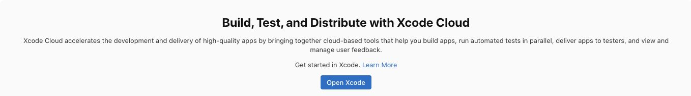

# Fideora — distribuição automática para TestFlight

21/10/2026. Auditoria antes da implementação, conforme .github/skills/apple-appstore-reviewer/SKILL.md.

## Estado inicial

O código e os ajustes de iPhone estão salvos na branch fideora-premium-v1. O GitHub compila e abre uma versão sem assinatura no simulador; não há workflow de distribuição. A build assinada 1.0.0 (1) foi enviada pelo titular e instalada pelo TestFlight. O painel Apple exibe “Get started in Xcode”: não existe produto/workflow Xcode Cloud ativado nesta equipe.



Escolha: Xcode Cloud, adequado ao projeto Capacitor existente. Não migrar o app para Expo apenas para compilar. A ativação inicial exige Xcode no Mac e autorização do repositório; não é uma dependência recorrente do Mac para cada build. Preparar código e validação antes de solicitar essa etapa.

## Riscos

| Prioridade | Área | Achado | Evidência | Impacto | Correção | Esforço | Confiança |
|---|---|---|---|---|---|---|---|
| P1 | Distribuição | CI atual não assina nem envia | ios-simulator.yml usa CODE_SIGNING_ALLOWED=NO | Não entrega atualizações ao iPhone | Xcode Cloud com archive e postação TestFlight | Médio | Verificado |
| P1 | Configuração nativa | Scheme não compartilhado e equipe ausente no Git | ios/App/App.xcodeproj | Onboarding/assinatura remota pode falhar | Scheme App compartilhado e equipe CZ7QKZBQC8 | Baixo | Verificado |
| P1 | Dependências | node_modules e assets são gerados; lock Swift não versionado | Package.swift aponta pacotes npm locais | Checkout limpo não compila sem preparo | Post-clone instala Node compatível, npm ci, testes, preflight e cap sync; versionar resolução Swift real | Médio | Verificado |
| P1 | Versão | 1.0.0 (1) já existe na Apple | TestFlight e teste físico | Primeira build Cloud pode colidir | Ajustar Next Build Number para 2 antes do primeiro envio | Baixo | Verificado |
| P1 | Escopo | main contém outra versão web | Histórico/repositório | Publicação do código errado | Workflow somente para fideora-premium-v1 e grupo interno existente | Baixo | Verificado |
| P2 | Ativação | Primeiro workflow só pode ser criado no Xcode | Painel Apple e documentação oficial | Não concluir pelo navegador | Uma ativação assistida no Mac; manutenção posterior pelo App Store Connect | Baixo | Verificado |

## Jornada e limites

GitHub → preparo e testes → archive assinado na Apple → processamento → grupo Fideora QA Interno → atualização no TestFlight. Sem novos destinatários. Não enviar para App Review. Os cenários de onboarding, grátis, Premium, compra/restauração/expiração, perfil, exclusão, links e offline continuam seguindo IPHONE-V2-REVIEW.md e PREMIUM-STORE-COPY.md; compilação remota não substitui aceite físico.

## Notas de revisão

Italian default, Portuguese optional. Free Genesis/Exodus and daily excerpt; other included books and advanced features require Apple IAP through RevenueCat. Email sync is optional. This change prepares build/distribution infrastructure; no app behavior, prices, entitlements or backend schema change. App Review readiness is not asserted.

## Configuração preparada no repositório

- Scheme App compartilhado, archive Release e equipe CZ7QKZBQC8 em Debug/Release.
- Script executável ios/App/ci_scripts/ci_post_clone.sh: Node 22 ou 24, instalação reprodutível npm ci, testes, preflight e geração/sincronização dos recursos iOS. O build falha se qualquer etapa falhar. Em Xcode Cloud, recusa equipe ou branch diferentes e exige o arquivo de resolução Swift.
- GitHub Actions executa o mesmo script no macOS, resolve dependências Swift, compila e abre o simulador. Não contém assinatura privada nem upload para Apple.
- Notas de TestFlight versionadas em ios/App/TestFlight/WhatToTest.it-IT.txt e WhatToTest.pt-BR.txt.
- Testes de falha do fluxo: equipe/branch erradas, referência de branch manual, falha de testes e falha de preflight.

## Ativação única no Xcode

O titular já tem um projeto Fideora funcional no Xcode, com a equipe correta. Ele pode iniciar a ativação por esse projeto; não precisa fazer outro archive local. O servidor deve selecionar a branch remota fideora-premium-v1 atualizada, que contém os scripts e o scheme compartilhado.

Para garantir que o Xcode analise a configuração atualizada, scripts/setup-xcode-cloud-mac.sh prepara um novo checkout no HD externo THALES HD 500GB, sem substituir o projeto anterior. Ele coloca projeto, dependências, cache npm e temporários em Fideora-Build no HD e abre o Xcode; não compila o binário nativo nem faz upload. O script é apenas para essa ativação inicial. DerivedData/Archives já configurados no HD permanecem como estão; Xcode/macOS ainda podem usar caches internos próprios.

1. Abrir o Fideora no Xcode e escolher **Integrate → Create Workflow**. Selecionar o produto App/com.fideora.app e a equipe CZ7QKZBQC8. Não criar outro app na Apple.
2. Revisar o workflow: usar a branch **fideora-premium-v1**, nunca main. Na primeira ativação, manter **Deployment Preparation = None** e não adicionar distribuição TestFlight ainda. Isso evita colidir com 1.0.0 (1) antes de configurar o contador Cloud.
3. Em **Grant Access**, conectar o GitHub **talescor-spec/mappa-cattolico**. Selecionar somente esse repositório, sem ampliar acesso a Herbalia ou outros projetos. A autorização de acesso e qualquer acordo novo apresentado pela Apple devem ser revisados pelo titular.
4. Completar a ativação e iniciar o primeiro build na branch fideora-premium-v1. Depois da ativação, o agente pode configurar os itens seguintes pelo App Store Connect. O Mac deixa de ser necessário para compilar ou enviar as próximas revisões.

## Finalização no App Store Connect após ativar

| Campo | Configuração |
|---|---|
| Nome | Fideora · TestFlight |
| Repositório | talescor-spec/mappa-cattolico |
| Start condition | Mudança em fideora-premium-v1; sem PRs nem main |
| Arquivos relevantes | src, public, ios, scripts, tests, package.json/package-lock.json, capacitor.config.json |
| Ambiente | macOS/Xcode estáveis suportados, sem betas |
| Projeto/scheme | ios/App/App.xcodeproj · App |
| Action | Archive · iOS · Release |
| Deployment Preparation | TestFlight and App Store; elegível para review futura, sem submissão automática |
| Postaction | TestFlight Internal Testing → Fideora QA Interno |
| Destinatários | Somente grupo existente; não convidar pessoas novas |
| Next Build Number | 2, ou maior que qualquer build enviada enquanto isso |
| Segredos adicionais | Nenhum certificado/chave privada no GitHub; assinatura gerenciada pela Apple |

Para o contador: Xcode Cloud → Settings → Build Number → Edit Next Build Number. Ajustar antes do primeiro envio para TestFlight. O número no projeto continua 1; no Cloud, a Apple atribui e incrementa o número da build. Não sobrescrever CFBundleVersion por script nem tentar deduzir a build a partir do SHA.

Somente declarar a distribuição automática concluída depois de conferir workflow ativo, archive Cloud assinado, upload processado e nova build disponível no grupo interno. A ativação inicial foi concluída pelo titular em 21/10/2026; a configuração da distribuição e o primeiro upload continuam em validação.

## Evidência de validação

- 25 testes e 24 verificações estruturais aprovados localmente. XML do scheme e sintaxe dos scripts conferidos. O preparo Mac foi verificado para recusar execução em Linux antes de modificar arquivos.
- CI de preparação: https://github.com/talescor-spec/mappa-cattolico/actions/runs/39672828582, concluído com sucesso. O mesmo post-clone passou no macOS; resolução Swift, compilação nativa, instalação e abertura no simulador foram aprovadas.
- Package.resolved foi copiado da resolução efetiva desse CI: Capacitor 8.5.2, ION Filesystem 2.0.1, PurchasesHybridCommon 19.12.0 e Purchases iOS 5.95.0, com revisões Git reais. O CI seguinte exige somente essas versões do lockfile.
- Conferência do lockfile em checkout limpo: https://github.com/talescor-spec/mappa-cattolico/actions/runs/39674679092, código 2ee092c330d1bda62db1d5d20a46bee438e26228, concluída com sucesso. Resolução estrita, compilação e abertura no simulador aprovadas. Esse CI sem assinatura não é um upload TestFlight.
- Produto Xcode Cloud criado: 71065e69-da01-400d-a130-d7c0b7870704, vinculado ao app Fideora 6825337165. Workflow inicial: 72A9DAC1-40CA-4668-90A5-B82BC97B071C.
- Next Build Number ajustado para 2 no App Store Connect antes da primeira execução.
- Primeira execução Cloud: build 2, 1534b863-2d5f-4504-a8cb-df37ac0e5520, iniciada manualmente na branch fideora-premium-v1, commit 1b8160840e339d59b392091b240e4c353b3b2441. Ação inicial Build - iOS, sem upload. O seletor de schemes para Archive estava vazio antes dessa primeira execução; não foi possível salvar o rascunho de distribuição. Não confundir esse rascunho com configuração publicada.
- A build 2 falhou no guard de equipe antes de instalar dependências. O log da Apple confirmou CI_TEAM_ID=1f404b10-6425-4a63-9483-a4bc8a3f49d7 (UUID da equipe App Store Connect), diferente do identificador de assinatura CZ7QKZBQC8. Corrigido o guard para o UUID observado; a assinatura mantém CZ7QKZBQC8. Testes recusam equipe ausente, diferente e o uso indevido do identificador de assinatura nesse campo. Sem dependências npm, a catalogação dos schemes também falhou nessa execução.
- Nenhuma chave privada foi extraída e nenhuma submissão para App Review foi realizada.

Comando de preparo inicial no Mac (script versionado na branch do projeto):

```sh
curl -fsSL https://raw.githubusercontent.com/talescor-spec/mappa-cattolico/fideora-premium-v1/scripts/setup-xcode-cloud-mac.sh | bash
```

O script é uma conveniência para baixar um checkout atualizado e abrir o projeto no HD externo. A ativação Apple continua sendo feita pelo titular no menu Integrate → Create Workflow. Depois dessa ligação inicial, configurar workflow, contador e grupo interno no painel, validar o primeiro upload e então considerar o fluxo ativo.

## Fontes

- https://developer.apple.com/documentation/xcode/configuring-your-first-xcode-cloud-workflow
- https://developer.apple.com/documentation/xcode/writing-custom-build-scripts
- https://developer.apple.com/documentation/xcode/making-dependencies-available-to-xcode-cloud
- https://developer.apple.com/documentation/xcode/setting-the-next-build-number-for-xcode-cloud-builds
- https://developer.apple.com/documentation/xcode/including-notes-for-testers-with-a-beta-release-of-your-app
